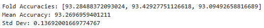
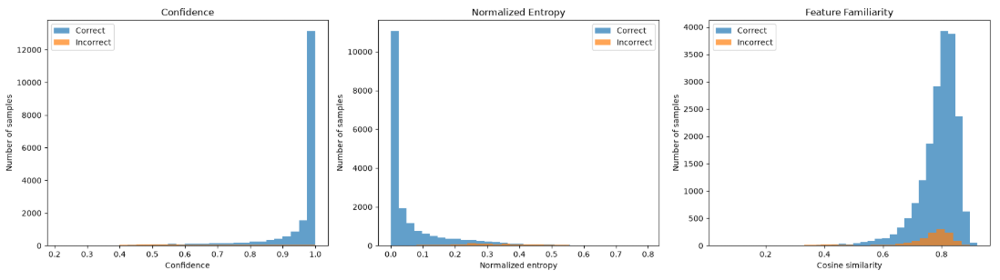
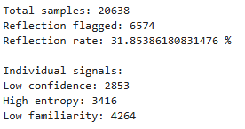
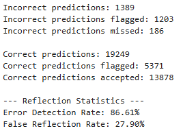
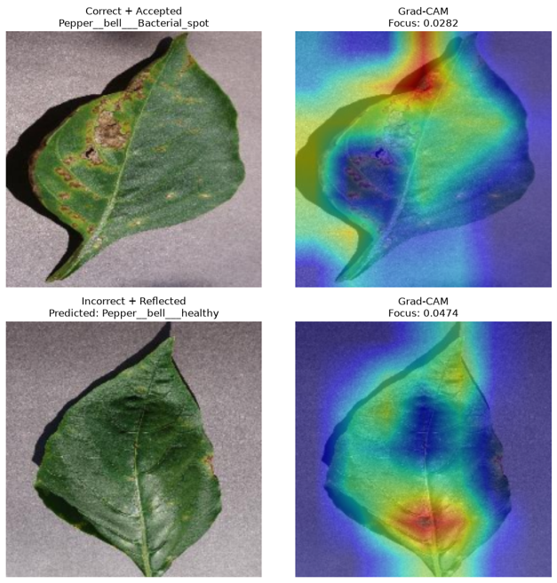
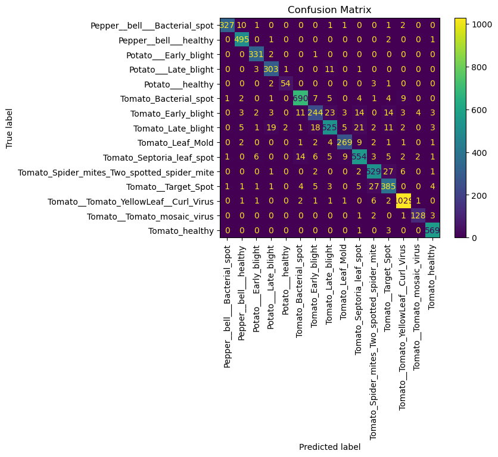
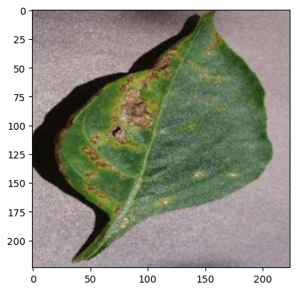

# Self-Reflective AI Assistant for Crop Disease Diagnosis

A research-oriented crop disease classification system investigating whether a vision model can assess the reliability of its own predictions.

## Project Overview

This project investigates a **self-reflective crop disease diagnosis system** built on top of a deep-learning image classifier.

The broader research objective is to develop an AI assistant that can:

1. classify crop diseases from leaf images,
2. assess the reliability of its own predictions,
3. identify predictions that should not be trusted automatically,
4. provide visual evidence for its prediction, and
5. eventually use reflection to support continual learning.

The current implementation corresponds to **PBL-3, Presentation 1**, and focuses specifically on the first working **self-reflection prototype**.

Continual learning, long-term memory, and reflection-driven model adaptation are intentionally deferred to the subsequent project phase.

---

## Current Research Question

### PBL-3

> **Can a vision model assess the reliability of its own prediction using additional model-derived evidence?**

The current prototype investigates this using:

- prediction confidence,
- predictive entropy,
- feature-space familiarity, and
- Grad-CAM-based visual evidence.

The individual components are established techniques. The research focus is their integration into a reflection-oriented reliability assessment layer for crop disease classification.

---

## System Concept

The current conceptual formulation is:

$$
R(x)=g(C,H,S,E)
$$

where:

- \(C\) = prediction confidence,
- \(H\) = predictive entropy,
- \(S\) = feature-space familiarity,
- \(E\) = explanation evidence from Grad-CAM.

The current numerical prototype evaluates:

$$
R(x)=g(C,H,S)
$$

while Grad-CAM is used as qualitative supporting evidence.

The reflection layer can therefore transform:

```text
Image
  ↓
Vision Model
  ↓
Prediction
  ↓
Reliability Assessment
  ↓
Accept / Flag for Review
```

The current implementation is a prototype and should not yet be interpreted as a final calibrated reliability system.

---

## Dataset

**Dataset:** PlantVillage
**Subset:** Pepper, Potato and Tomato
**Images:** 20,638
**Classes:** 15

### Classes

* Pepper Bell Bacterial Spot
* Pepper Bell Healthy
* Potato Early Blight
* Potato Late Blight
* Potato Healthy
* Tomato Bacterial Spot
* Tomato Early Blight
* Tomato Late Blight
* Tomato Leaf Mold
* Tomato Septoria Leaf Spot
* Tomato Spider Mites
* Tomato Target Spot
* Tomato Yellow Leaf Curl Virus
* Tomato Mosaic Virus
* Tomato Healthy

The dataset is **not included in this repository**.

---

## Baseline Model

The classification baseline uses:

* **Architecture:** MobileNetV3-Small
* **Pretraining:** ImageNet
* **Input size:** 224 × 224
* **Transfer learning:** Yes
* **Feature extractor:** Frozen
* **Trainable component:** Final classifier layer

The baseline provides the initial prediction on which the reflection layer operates.

---

## Validation Strategy

The model is evaluated using **3-fold stratified cross-validation**.

Out-of-fold (OOF) predictions are collected so that each image is evaluated using a model that did not use that image for training.

### Current Baseline Results

| Fold          |   Accuracy |
| ------------- | ---------: |
| Fold 1        |     93.28% |
| Fold 2        |     93.43% |
| Fold 3        |     93.09% |
| **Mean**      | **93.27%** |
| **Std. Dev.** |  **0.14%** |

These results establish the current PBL-3 baseline before reflection.

### Cross-Validation Results



---

# Self-Reflection Prototype

The current prototype evaluates three numerical reliability signals.

## 1. Prediction Confidence

$$
C(x)=\max_k p_k
$$

The maximum predicted class probability provides a direct measure of how concentrated the model's prediction is around its selected class.

---

## 2. Predictive Entropy

$$
H(x)=-\sum_k p_k\log p_k
$$

Entropy considers the complete probability distribution.

* Lower entropy → more concentrated prediction
* Higher entropy → more distributed prediction

Normalized entropy is used in the current implementation.

---

## 3. Feature-Space Familiarity

The model's internal representation is compared with the prototype of the predicted class using cosine similarity:

$$
S(x)=\cos(f(x),\mu_{\hat y})
$$

where:

* \(f(x)\) is the image feature representation,
* \(\mu_{\hat y}\) is the prototype of the predicted class.

This provides a second source of evidence beyond the output probability distribution.

---

## Reflection Signal Distributions

The distributions of confidence, normalized entropy, and feature-space familiarity are examined separately for correct and incorrect predictions.



These distributions provide the basis for investigating whether model-internal signals can distinguish reliable predictions from potentially unreliable ones.

---

# Provisional Reflection Rule

The current prototype uses provisional thresholds:

```text
Confidence < 0.80
OR
Normalized Entropy > 0.20
OR
Familiarity < 0.75
        ↓
Flag prediction for reflection/review
```

These thresholds are **prototype values**, not final experimentally optimized thresholds.

They were selected using the observed OOF signal distributions. Therefore, the resulting prototype reflection statistics are not presented as the final leakage-free evaluation of the method.

Formal threshold selection, calibration, selective prediction, risk-coverage analysis, and comparative experiments are part of the next evaluation phase.

---

# Prototype Reflection Evaluation

The prototype was evaluated using out-of-fold predictions from the 3-fold classification experiment.

### Overall statistics

* Total samples: **20,638**
* Reflection flagged: **6,574**
* Reflection rate: **31.85%**

### Individual signals

* Low confidence: **2,853**
* High entropy: **3,416**
* Low familiarity: **4,264**



### Prediction and reflection statistics

* Incorrect predictions: **1,389**
* Incorrect predictions flagged: **1,203**
* Incorrect predictions missed: **186**
* Correct predictions: **19,249**
* Correct predictions flagged: **5,371**
* Correct predictions accepted: **13,878**

The resulting prototype statistics are:

* Apparent error detection rate: **86.61%**
* False reflection rate: **27.90%**



### Important Evaluation Note

The current thresholds were selected provisionally after inspecting the available out-of-fold signal distributions and then evaluated on the same prototype dataset.

Consequently, the reported **86.61% error detection rate and 27.90% false reflection rate should not be interpreted as final generalization performance**.

A later evaluation phase will use a cleaner threshold-selection and evaluation protocol, together with calibration and selective-prediction analysis.

---

# Explainability with Grad-CAM

Grad-CAM / Guided Grad-CAM is used to visualize regions contributing to the model's prediction.

In the reflection prototype, explanations are particularly useful for examining cases where the model:

* makes a correct prediction and accepts it,
* makes an incorrect prediction but flags it for review.

The explanations are treated as **qualitative evidence** supporting the reflection process.

They are not interpreted as proof of biological correctness because lesion-level ground-truth localization is not available in the current dataset.



---

# Existing Baseline Visualizations

The original classification pipeline also includes the following visual analyses.

### Confusion Matrix



### Guided Grad-CAM


### Sample Prediction



---

# Current Project Status

## PBL-2 — Completed

Established:

* PlantVillage dataset subset
* MobileNetV3-Small baseline
* transfer learning
* cross-validation
* Grad-CAM-based explainability

## PBL-3 — Current

Developing:

* prediction reliability assessment
* confidence analysis
* entropy-based uncertainty
* feature-space familiarity
* reflection decision rule
* initial reflection prototype

## PBL-3 — Next Evaluation Phase

Evaluate whether reflection actually improves decision reliability through:

* threshold selection,
* calibration,
* selective prediction,
* risk-coverage analysis,
* ablation studies,
* baseline vs. reflection comparisons.

## PBL-4 — Future

The longer-term system will investigate:

* reflection-driven continual learning,
* memory of previous cases,
* adaptation to new disease patterns,
* catastrophic forgetting,
* and the integrated reflective AI assistant.

---

# Repository Structure

```text
Crop-Disease-Reflective-AI/
│
├── models/
│   └── best_model.pth
│
├── notebook/
│   ├── plant_disease_baseline_model.ipynb
│   ├── plant_disease_model_with_grad_cam.ipynb
│   └── plant_disease_model_with_reflective_prototype.ipynb
│
├── results/
│   ├── confusion_matrix.png
│   ├── cv_results.png
│   ├── guided_gradcam.png
│   ├── reflection_evaluation_signals.png
│   ├── reflection_evaluation_stats.png
│   ├── reflection_gradcam.png
│   ├── reflection_signal_distribution.png
│   └── sample_prediction.png
│
├── README.md
├── index.html
└── requirements.txt
```

The PlantVillage dataset is not included in the repository.

---

# Installation

Create the required Python environment and install the dependencies:

```bash
pip install -r requirements.txt
```

Then launch Jupyter:

```bash
jupyter notebook
```

Open the notebooks under:

```text
notebook/
```

The main notebook for the current PBL-3 prototype is:

```text
notebook/plant_disease_model_with_reflective_prototype.ipynb
```

The dataset should be placed locally according to the dataset path expected by the notebook.

PyTorch and Torchvision should be installed as a compatible pair appropriate to the available operating system and CUDA configuration.

---

# Reproducibility

The notebook records the experimental configuration and preserves the outputs from the current prototype run.

The current baseline should therefore be regarded as an experimental reference point rather than a final benchmark.

Future evaluation will introduce stricter reproducibility controls and independent evaluation protocols where required.

---

# Research References

## Primary Reliability Reference

**Zhou, M., Meng, Y., Xu, M., Abdullah, E. R. M. F., Sabri, A. Q. M., & Rahardja, S. (2026).**

*Towards reliable recognition for plant diseases and weeds by learning soft probability population.*

Engineering Applications of Artificial Intelligence, 167, 113618.

DOI: 10.1016/j.engappai.2025.113618

This work is particularly relevant to the project's reliability-oriented direction because it frames plant-disease recognition around determining whether predictions can be trusted and when intervention is preferable for unknown inputs.

Paper: [https://doi.org/10.1016/j.engappai.2025.113618](https://doi.org/10.1016/j.engappai.2025.113618)

Public implementation: [https://github.com/xml94/SPP4OOD](https://github.com/xml94/SPP4OOD)

## Supporting Uncertainty Reference

**Hernández, S., & López, J. L. (2020).**

*Uncertainty quantification for plant disease detection using Bayesian deep learning.*

Applied Soft Computing, 96, 106597.

DOI: 10.1016/j.asoc.2020.106597

This work provides direct precedent for treating predictive uncertainty as an important consideration in plant disease detection rather than relying solely on classification accuracy.

---

# Technical References

1. **PyTorch Documentation**
   [https://pytorch.org/docs/stable/index.html](https://pytorch.org/docs/stable/index.html)

2. **Torchvision MobileNetV3-Small**
   [https://pytorch.org/vision/stable/models/generated/torchvision.models.mobilenet_v3_small.html](https://pytorch.org/vision/stable/models/generated/torchvision.models.mobilenet_v3_small.html)

3. **PyTorch Transfer Learning Tutorial**
   [https://pytorch.org/tutorials/beginner/transfer_learning_tutorial.html](https://pytorch.org/tutorials/beginner/transfer_learning_tutorial.html)

4. **PlantVillage Dataset**
   Hughes, D. P., & Salathé, M. (2015).
   *An open access repository of images on plant health to enable the development of mobile disease diagnostics.*

5. **Grad-CAM**
   Selvaraju, R. R., et al. (2017).
   *Grad-CAM: Visual Explanations from Deep Networks via Gradient-based Localization.*
   ICCV 2017.
   [https://arxiv.org/abs/1610.02391](https://arxiv.org/abs/1610.02391)

6. **pytorch-grad-cam**
   [https://github.com/jacobgil/pytorch-grad-cam](https://github.com/jacobgil/pytorch-grad-cam)

---

# Acknowledgements

This project was developed using PyTorch, Torchvision, and open research resources.

The implementation and experiments were developed and adapted for the project's research objectives and the selected PlantVillage subset.

Model training and experimentation were performed using GPU resources provided by **Manipal University Jaipur**.

---

# Research Disclaimer

This repository represents an ongoing undergraduate research project.

The current self-reflection mechanism is a **prototype**, not a clinically or agriculturally validated diagnostic system.

High classification accuracy on PlantVillage should not be interpreted as equivalent to reliable performance under real-world field conditions. Further evaluation under distribution shift, calibration, selective prediction, and independent datasets is required before practical deployment.
