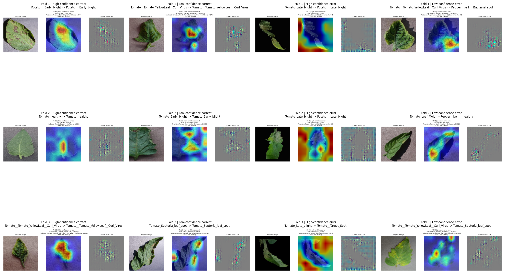

# Self-Reflective and Continually-Learning AI Assistant for Crop Disease Diagnosis

A research project investigating whether a crop-disease classifier can tell when its own prediction is likely to be wrong, using prediction confidence, predictive entropy and feature-space familiarity.

**Author:** Chinmaya (Reg. No. 2427030604) · **Supervisor:** Dr. Amit Kumar Gupta
**Institution:** Department of Computer Science and Engineering, Manipal University Jaipur (B.Tech, PBL-III, 2026–27)

**Current status:** PBL-III experimental reliability-assessment prototype. It flags potentially unreliable predictions. It does not correct classifications, update model weights from user feedback, or implement continual learning.

## Project Phases

- **PBL-I / PBL-II:** Initial classification and explainability pipeline (MobileNetV3-Small baseline, Grad-CAM).
- **PBL-III (this repository):** Three-architecture comparison and out-of-fold evaluation of prediction-reliability signals.
- **PBL-IV (planned):** Verified feedback and continual learning.

## Dataset

| Property | Description |
|---|---|
| Source | [PlantVillage on Kaggle](https://www.kaggle.com/datasets/emmarex/plantdisease) |
| Selected categories | Pepper, Potato, Tomato |
| Images | 20,638 |
| Classes | 15 (class-imbalanced: 152 to 3,208 images per class) |

The dataset is not included in this repository.

## Classification Models

Three ImageNet-pretrained CNNs were used with a new 15-class classifier head. The pretrained backbone was frozen and only the final linear layer was trained (Adam, learning rate 0.001, 10 epochs, batch size 32, 224×224 input, no augmentation). Stratified three-fold cross-validation produced an out-of-fold (OOF) prediction for every image.

| Architecture | Mean OOF accuracy | Std. dev. (folds) | Errors |
|---|---:|---:|---:|
| MobileNetV3-Small | 93.3279% | 0.1395% | 1,377 |
| ResNet18 | 93.3327% | 0.3949% | 1,376 |
| **EfficientNet-B0** | **94.6555%** | 0.4022% | **1,103** |

EfficientNet-B0 improved accuracy by about 1.32 percentage points over the other two architectures.

## Reliability Assessment

Three signals were computed from each prediction:

- **Confidence (C):** 1 − maximum softmax probability.
- **Entropy (H):** predictive entropy normalized by log(15).
- **Familiarity (S):** 1 − cosine similarity between the image embedding and the prototype of its predicted class (prototypes built from training-fold embeddings only).

Logistic-regression risk models were fitted on combinations of the signals and compared with a low-confidence baseline.

### Error-ranking ability (AUROC, incorrect vs correct predictions)

| Signal | MobileNetV3-Small | ResNet18 | EfficientNet-B0 |
|---|---:|---:|---:|
| C (low confidence) | 0.9221 | 0.9221 | 0.9444 |
| H (normalized entropy) | 0.9163 | 0.9161 | 0.9353 |
| S (low familiarity) | 0.6329 | 0.6790 | 0.6265 |

### Threshold-based flagging (test partitions, 90% calibration-recall target)

| Architecture | Method | Error recall (%) | Precision (%) | Coverage (%) |
|---|---|---:|---:|---:|
| MobileNetV3-Small | Baseline (C) | 85.03 | 27.01 | 79.01 |
| MobileNetV3-Small | C+H+S | 87.50 | 25.93 | 77.50 |
| ResNet18 | Baseline (C) | 92.73 | 22.12 | 72.05 |
| ResNet18 | C+H+S | 92.30 | 22.79 | 73.00 |
| EfficientNet-B0 | Baseline (C) | 92.93 | 25.73 | 80.68 |
| EfficientNet-B0 | C+H+S | 92.39 | 26.90 | 81.63 |

Thresholds were chosen on a separate calibration split and applied unchanged to the test split, so test recall differs from the 90% target. Values are pooled over 2 split seeds × 3 folds (6 partitions per architecture). The full table for all eight methods is in `results/classification/cross_validation/` and `results/reliability/`.

### Main findings

- Confidence was the strongest standalone signal for ranking incorrect predictions.
- Entropy was almost redundant with confidence (Spearman correlation ≈ 0.9986).
- Familiarity was weak as a standalone signal.
- Combining signals did not consistently improve error detection: gains and losses were architecture-dependent and small.
- A paired image-cluster bootstrap (10,000 replicates, 18 method-versus-baseline contrasts, Bonferroni-adjusted intervals) did not establish a statistically supported AURC improvement over the confidence baseline for any combination.
- Brier score, negative log-likelihood and adaptive ECE differences were small and are reported descriptively.

Additional ablations and a per-method breakdown are in the result files listed below.

## Explainability

Grad-CAM (MobileNetV3-Small, last convolutional feature layer, 7×7) was used to qualitatively inspect correct and incorrect OOF predictions, including highly confident misclassifications. The maps are coarse and qualitative: they do not establish biological validity or lesion-localization accuracy, and Grad-CAM is not used as a numerical reliability score.



## Repository Structure

```text
crop_disease_ml_project/
├── models/
│   └── best_model.pth        # MobileNetV3-Small, best-fold checkpoint (baseline)
├── notebook/
│   └── three_models_reflective_mechanism.ipynb   # full experiment pipeline
├── results/
│   ├── classification/       # per-fold and pooled results, class-wise errors, confusions
│   ├── reliability/          # calibration, familiarity, risk-coverage, bootstrap, manifests
│   └── explainability/       # Grad-CAM contact sheet
├── index.html                # self-contained project presentation (open in a browser)
├── requirements.txt
└── README.md
```

Only the MobileNetV3-Small baseline checkpoint is included. The ResNet18 and EfficientNet-B0 checkpoints, OOF prediction arrays and the dataset are not stored in this repository.

## Selected Results Files

**Classification**
- [Cross-validation results](results/classification/cross_validation/)
- [Class-wise performance](results/classification/classwise_analysis/classwise_oof_performance.csv)
- [Top class confusions](results/classification/confusion_analysis/top_class_confusions.csv)

**Reliability**
- [Calibration summary](results/reliability/calibration/evaluation_v3_corrected_error_calibration_summary.csv)
- [Risk-coverage summary](results/reliability/risk_coverage/evaluation_v3_corrected_risk_coverage_summary.csv)
- [Paired bootstrap analysis](results/reliability/risk_coverage/evaluation_v3_corrected_paired_bootstrap.csv)
- [Familiarity analysis](results/reliability/familiarity/corrected_familiarity_summary.csv)

**Experimental metadata**
- [Evaluation manifests](results/reliability/metadata/) (seeds, split proportions, threshold rule, bootstrap settings)

## Reproducing the Experiments

1. Install the dependencies:

   ```bash
   pip install -r requirements.txt
   ```

2. Download [PlantVillage](https://www.kaggle.com/datasets/emmarex/plantdisease) and keep only the Pepper, Potato and Tomato folders (15 classes, 20,638 images).
3. Open `notebook/three_models_reflective_mechanism.ipynb`. It was run on Kaggle, so the dataset and output paths near the top of the notebook point to `/kaggle/...`. Edit `DATASET_DIR` and `PROJECT_DIR` to match your machine.
4. Run the cells in order. A CUDA GPU is recommended. Reference environment: Python 3.13, PyTorch 2.11, TorchVision 0.26, scikit-learn 1.6.1, 2× Tesla T4.

Fixed settings: stratified 3-fold split with `random_state = 42`; evaluation split seeds 20261109 and 20262109 (50% meta-training / 25% calibration / 25% test); target calibration error recall 90%; AURC bootstrap seed 20261111. The reflection stage does not retrain the CNNs. Exact numbers can vary slightly across hardware and library versions.

## Limitations

- Evaluation uses a selected PlantVillage subset, not independently collected field images.
- The class distribution is imbalanced.
- Only the final classifier layer was trained.
- Generalization to unseen diseases, field conditions and external datasets has not been established.
- Familiarity similarity is not a calibrated probability of correctness.
- Grad-CAM results are qualitative.
- The current system does not learn from user feedback.

## Future Work

- Testing on field-collected crop images and external datasets.
- Evaluation under distribution shift.
- Improved uncertainty and familiarity estimation.
- Verified feedback and label correction.
- Continual-learning experiments, including catastrophic-forgetting evaluation.

## Disclaimer

This is an undergraduate research project and an experimental reliability-assessment prototype. Classification performance on PlantVillage should not be interpreted as proof of reliable performance under real-world agricultural conditions.
