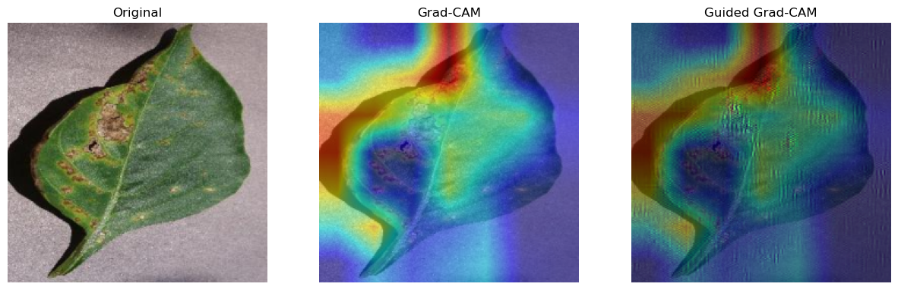

# Crop Disease Classification using Transfer Learning

## Overview
This project classifies crop leaf diseases using a pretrained MobileNetV3-Small model and the PlantVillage dataset.

The model is trained using transfer learning and evaluated with 3-fold cross-validation.

## Dataset
- Dataset: PlantVillage (Pepper, Potato and Tomato subset)
- Total Images: 20,638
- Total Classes: 15

Classes:
- Pepper Bell Bacterial Spot
- Pepper Bell Healthy
- Potato Early Blight
- Potato Late Blight
- Potato Healthy
- Tomato Bacterial Spot
- Tomato Early Blight
- Tomato Late Blight
- Tomato Leaf Mold
- Tomato Septoria Leaf Spot
- Tomato Spider Mites
- Tomato Target Spot
- Tomato Yellow Leaf Curl Virus
- Tomato Mosaic Virus
- Tomato Healthy

## Model
- Backbone: MobileNetV3-Small
- Pretrained on ImageNet
- Only the final classifier layer was trained

## Validation Method
3-Fold Cross Validation

| Fold | Accuracy |
|------|------|
| Fold 1 | 93.24% |
| Fold 2 | 92.92% |
| Fold 3 | 93.50% |

- Mean Accuracy: 93.22%
- Standard Deviation: 0.24%
- Best Fold: Fold 3

## Confusion Matrix


## Guided Grad-CAM



## Sample Prediction


## Discussion
The model performs consistently across folds with very low variance. Most errors occur between visually similar tomato diseases such as Early Blight, Late Blight and Target Spot.

Guided Grad-CAM shows that the model focuses primarily on diseased regions of the leaf rather than the background.

## Run the Project

```bash
pip install -r requirements.txt
jupyter notebook notebook/plant_disease_model_with_grad_cam.ipynb
```

## Code References / Acknowledgements

This project was implemented using PyTorch and transfer learning concepts.  
The implementation was developed by referring to official documentation and educational resources, which were adapted to the PlantVillage dataset and project requirements.

Primary references:

1. PyTorch Official Documentation  
   https://pytorch.org/docs/stable/index.html  

2. Torchvision Models Documentation (MobileNet)  
   https://pytorch.org/vision/stable/models.html  

3. PyTorch Transfer Learning Tutorial  
   https://pytorch.org/tutorials/beginner/transfer_learning_tutorial.html  

4. PlantVillage Dataset  
   Hughes, D. P., & Salathé, M. (2015).  
   An open access repository of images on plant health to enable the development of mobile disease diagnostics.  
   https://www.kaggle.com/datasets/emmarex/plantdisease  

The code structure and training pipeline were adapted and modified specifically for this project.
